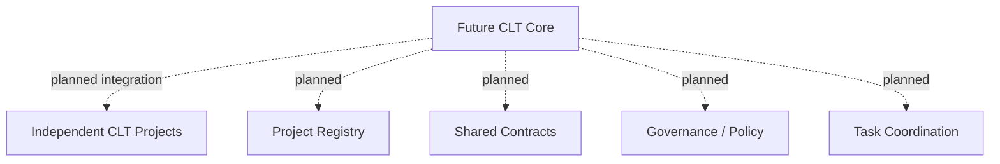

# CLT Core Monorepo

[](#proof-of-concept--enterprise-customization-readiness)

**CLT Core Monorepo is currently an empty repository reserved for a future central coordination layer for the Cloudy_Lap_top (CLT) ecosystem.**

The default branch currently contains no application source files, package manifests, tests, deployment workflows, or runtime configuration. This README documents the repository's present state; it does not imply that a monorepo platform has been implemented.

## 1. Project Overview & Problem Statement

The repository description identifies the intended direction as the central intelligence layer for the CLT ecosystem. A future implementation could provide shared contracts, repository registry, task coordination, policy evaluation, and cross-project integration.

No such capabilities are present in the current default-branch tree. This repository is currently a placeholder for that direction.

### Intended future boundary



The diagram is conceptual only; none of these components currently exists in this repository.

## 2. Tech Stack & Versions

No programming language, framework, runtime, or dependency set is selected in the current repository tree.

Do not infer a Python, Node.js, Docker, database, or AI runtime from the repository name or description.

## 3. Prerequisites & Dependencies

No build tools or runtime dependencies are required to inspect this repository.

A future implementation must select and document its language/runtime, dependency policy, license requirements, and CI baseline before development begins.

## 4. Installation & Local Setup

There is no application to install or run at this time.

```bash
git clone https://github.com/zopair/CLT-Core-Monorepo.git
cd CLT-Core-Monorepo
```

The clone contains this README after this documentation change. No build, start, or test command is currently available.

## 5. Environment Variables

No environment variables, credentials, API keys, or runtime configuration are defined by the current repository.

Do not add shared secrets or project credentials until an approved implementation and secret-management model exist.

## 6. Usage Guide & Core Features

No executable features are implemented.

Potential future areas, subject to a separately approved architecture, include:

- Project and service registry.
- Shared versioned contracts.
- Cross-repository task coordination.
- Policy and capability boundaries.
- Evidence-backed health and delivery status.
- Human-reviewed change proposals.

These are future design possibilities, not current features or commitments.

## 7. Live Demo & Screenshots

No application, API, static site, or live demo is deployed from this repository.

## 8. Testing & Verification

No tests, CI workflows, static analysis, or deployment checks are present in the current default-branch tree.

The initial engineering gate should add a minimal test/CI baseline alongside the first actual implementation, not create workflows that only report placeholder success.

## Proof of Concept & Enterprise Customization Readiness

**Status: Empty repository / concept placeholder.**

| Area | Current state |
|---|---|
| Application source | None |
| Architecture implementation | None; conceptual direction only |
| Dependencies | None declared |
| Environment configuration | None |
| Tests | None |
| CI / deployment | None |
| Integrations | None |
| Project license | No root `LICENSE` file present |

The repository is not currently a PoC or MVP implementation. It becomes one only after the first runnable, tested component is added.

## Intellectual Property & Authorship

Project direction and requested attribution: **Aly Hussein Zopair (علي حسين زبير ALY HUSSEIN ZOPAIR)**.

This attribution does not create a software license or establish rights to third-party code that may be added in the future.
